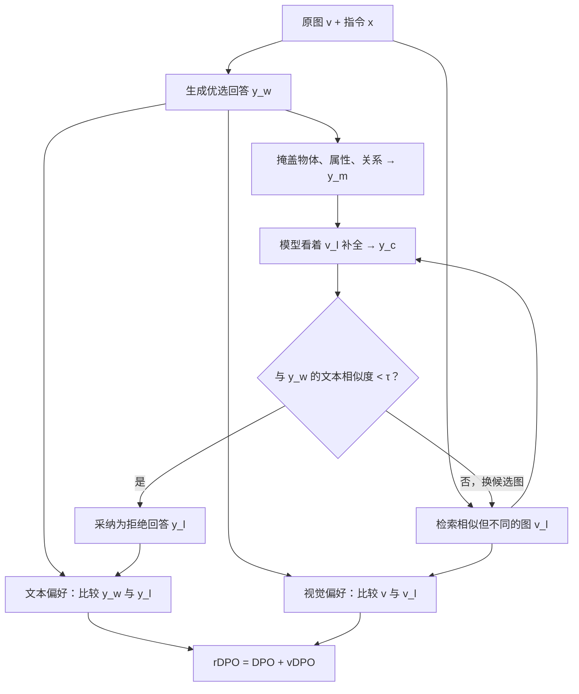

# Re-Align 阅读报告

**Re-Align: Aligning Vision Language Models via Retrieval-Augmented Direct Preference Optimization**  
（用检索增强的直接偏好优化对齐视觉语言模型）

> **出处**：EMNLP 2025 主会  
> **代码**：<https://github.com/taco-group/Re-Align>  
> **阅读主线**：解决什么任务 → 传统方法怎么做 → 还存在什么问题 → 本文如何逐步解决

**核心概括：** Re-Align 研究的是如何减少视觉语言模型的跨模态幻觉。它的关键设计是：先用一张与原图语义相近、但实际不同的图像诱导模型产生错误回答，再把这张检索图用于视觉偏好训练，让模型同时学会“哪个回答更好”和“哪张图更支持这个回答”。

## 一、文章解决了什么下游任务？

本文解决的是**视觉语言模型的跨模态幻觉抑制问题**。

视觉语言模型（VLM）能够同时接收图像和文字，并根据图像回答问题或生成描述，例如 LLaVA。所谓跨模态幻觉，就是模型生成的文字缺少图像依据，表现为编造图中不存在的物体、说错物体的颜色或动作、描述错误的空间或逻辑关系。例如，图中只有一个人和一只猫，模型却回答“一个人正在遛狗”。问题不在于语句不通顺，而在于语句与视觉证据不一致。

因此，这项任务的目标不是单纯提高语言生成能力，而是让模型的回答**忠实于当前输入图像**，减少“说得像真的，但图中并非如此”的内容。它本质上属于视觉语言模型的后训练对齐：模型已经具备读图和作答能力，现在需要进一步调整其输出偏好，使正确答案更符合视觉事实。

## 二、传统做法都是怎么解决的？

传统方法通常借鉴大语言模型中的人类反馈对齐思路。早期 RLHF 方法先收集人类对回答优劣的判断，训练奖励模型，再通过强化学习调整 VLM。后来广泛应用的是 DPO（Direct Preference Optimization，直接偏好优化），它不需要单独训练奖励模型，而是直接在偏好数据上微调。

一条标准偏好数据可以写成 $(x,v,y_w,y_l)$：$x$ 是问题或指令，$v$ 是输入图像，$y_w$ 是优选回答，也叫 chosen；$y_l$ 是较差回答，也叫 rejected。训练的目标是：在相同指令和图像下，让模型更倾向于生成 $y_w$，而不是 $y_l$。其损失为：

$$
\mathcal{L}_{\text{DPO}}=-\mathbb{E}\!\left[\log\sigma\!\left(\beta\log\frac{\pi_\theta(y_w\mid x,v)}{\pi_0(y_w\mid x,v)}-\beta\log\frac{\pi_\theta(y_l\mid x,v)}{\pi_0(y_l\mid x,v)}\right)\right].
$$

这里，$\pi_\theta$ 是正在训练的模型，$\pi_0$ 是参考模型，$\beta$ 控制偏好优化相对参考模型的强度，$\sigma$ 是 sigmoid 函数。直观理解就是：拉大优选回答与拒绝回答的相对对数概率差。

围绕这套框架，传统工作主要有两类数据构造方式。第一类是**制造拒绝回答**：直接扰动正确文本，或者对图像加噪、裁剪，再让模型产生错误输出。这类方法容易批量生成数据，但错误可能是人为强加的。第二类是**提高优选回答质量**：由人工或更强的模型重写、精炼回答。这类数据较可靠，但构造和审核成本更高。

## 三、本文发现了什么此前解决不好的问题？

本文指出的新问题不是“VLM 会幻觉”这一现象本身，而是**现有偏好对齐方法在数据和目标上都没有充分处理视觉幻觉**。

第一个问题是，**拒绝回答不一定接近模型自己真实会犯的错误**。如果错误主要来自人为改词、加噪或裁剪，模型学到的可能只是识别这些人为扰动，而不是纠正自身在读图时的失败模式。也就是说，训练数据里有“坏回答”，但这些坏回答未必来自模型自然的生成行为。

第二个问题是，**标准 DPO 缺少直接的视觉偏好比较**。在同一个 $(x,v)$ 下比较 $y_w$ 和 $y_l$ 时，图像始终固定，损失的直接比较对象是两个文本回答。它能告诉模型“哪个回答更好”，却没有显式告诉模型“同一个回答换一张图后，是否仍然成立”。对于图文不一致问题，仅靠文本偏好并不充分。

已有的视觉改进方法会使用随机裁剪图等作为对照，但随机破坏可能损害图像语义。于是仍缺少一个统一方案：既让模型自己产生较自然的错误，又把有语义意义的视觉对照放进训练目标。Re-Align 正是针对这个缺口展开。

## 四、本文具体怎么做？

核心思想可以概括为：**用相似图诱导错误，再用这张图提供视觉对照。** 一张检索图在整个流程中承担两个作用：既帮助构造拒绝回答，又参与视觉偏好优化。

### 第一步：生成优选回答

给定训练图像 $v$ 和指令 $x$，先由较强的视觉语言模型生成高质量回答 $y_w$。它代表在原图条件下应当被优先选择的回答，也是后续构造错误回答的起点。

### 第二步：掩盖容易出现幻觉的内容

将 $y_w$ 中涉及**物体、属性和逻辑关系**的片段替换为 `[MASK]`，得到 $y_m$。这里不是直接把这些内容改成错误答案，而是先留空，让模型之后自己补全。这样做是为了让错误来自模型的生成过程，而不是由人强行注入。

### 第三步：检索一张相似但不同的图像

在训练图像库中，根据图像向量的余弦相似度，为原图 $v$ 检索若干候选图。候选图与原图语义相近，但并非同一张，记为 $v_l$。选择相似图而不是完全无关的随机图，是为了形成更有意义的视觉干扰：场景可能相近，但具体物体、属性或关系不同，模型更容易把候选图中的内容错误地写入原回答。

### 第四步：让模型看着检索图补全，并筛选错误回答

把掩码回答 $y_m$ 和检索图 $v_l$ 交给容易产生幻觉的预训练 VLM，让它补全为候选回答 $y_c$。由于模型看到的是另一张图，补全内容可能出现“张冠李戴”。随后计算 $y_c$ 与原优选回答 $y_w$ 的文本相似度，只有相似度低于阈值 $\tau$ 时，才把 $y_c$ 采纳为拒绝回答 $y_l$；否则换下一张候选图。正文设定 $\tau=0.95$。这一筛选用于保证拒绝回答与优选回答之间存在足够文本差异。

至此得到双重偏好数据：

$$
(x,v,v_l,y_w,y_l).
$$

与标准 DPO 数据相比，它额外保留了检索图 $v_l$，为下一步的视觉比较提供条件。

### 第五步：用 rDPO 同时学习文本偏好和视觉偏好

文本侧仍使用标准 DPO：固定原图 $v$，比较 $y_w$ 与 $y_l$。视觉侧新增 vDPO：固定同一个优选回答 $y_w$，比较原图 $v$ 与检索图 $v_l$：

$$
\mathcal{L}_{\text{vDPO}}=-\mathbb{E}\!\left[\log\sigma\!\left(\beta\log\frac{\pi_\theta(y_w\mid x,v)}{\pi_0(y_w\mid x,v)}-\beta\log\frac{\pi_\theta(y_w\mid x,v_l)}{\pi_0(y_w\mid x,v_l)}\right)\right].
$$

这个公式要求：对于同一个正确回答，模型在原图下的相对似然应高于在检索图下的相对似然。它直接表达了“**原图比相似但不同的图更支持这个回答**”。最终目标为：

$$
\mathcal{L}_{\text{rDPO}}=\mathcal{L}_{\text{DPO}}+\mathcal{L}_{\text{vDPO}}.
$$

两种比较可以简明地区分为：

| 比较类型      | 固定什么          | 比较什么              | 学习目的          |
| --------- | ------------- | ----------------- | ------------- |
| 文本偏好 DPO  | 同一指令、同一原图     | $y_w$ 与 $y_l$     | 倾向正确回答，抑制错误回答 |
| 视觉偏好 vDPO | 同一指令、同一 $y_w$ | 原图 $v$ 与检索图 $v_l$ | 让回答依赖正确的视觉证据  |

## 五、读完需要记住什么？

Re-Align 的逻辑链条非常明确：传统 DPO 的负回答可能不够自然，而且视觉条件没有直接参与比较；本文先用“**片段掩盖 + 相似图检索 + 模型补全 + 相似度筛选**”构造拒绝回答，再用“**DPO 文本偏好 + vDPO 视觉偏好**”训练模型。检索图同时连接了数据构造与优化目标，这是全文最核心的贡献。

